# dipspot_ie_manager

## TradePulse EXIM 🌐
### Enterprise-Grade Global Export-Import Analytical Operating System

TradePulse EXIM is a modern, high-performance Export-Import Analytical OS designed for international commodity trading (Agricultural Grains, Basmati & Non-Basmati Rice, Sugar, Spices, Textiles, Chemicals, Metals, and FMCG).

The platform tracks international buyers, manages deals through a tactile **Drag-and-Drop Pipeline Kanban Board**, automates outbound sequences with **Gmail SMTP Gateway** integration, monitors ocean container freight across global trade corridors, provides live **Public Parcel/Cargo Progression tracking** for foreign buyers, and executes configured **Competitor Pricing & Market Intelligence**.

---

## 📁 Repository Architecture

The project is cleanly partitioned into only two core application folders with root scripts:

```
web-scrapper/
├── backend/                       # All backend code (Flask 3.1 REST API + SQLite/MongoDB)
│   ├── app/                       # Application modules, models, scrapers & routes
│   │   ├── routes/                # leads, pipeline, campaigns, shipments, intelligence, config
│   │   ├── scrapers/              # Universal directory parsers (incremental & dynamic)
│   │   ├── db.py                  # Dual SQLite & MongoDB live synchronization
│   │   ├── factory.py             # Flask factory & CORS configuration
│   │   └── models.py              # Lead & Trade intelligence models + geocoding resolvers
│   ├── instance/                  # Local SQLite database
│   ├── tests/                     # 133 automated unit, crawler, & route-based filtration tests
│   ├── Dockerfile                 # Backend container definition
│   ├── requirements.txt           # Python dependencies
│   ├── run.py                     # Flask server entrypoint (Port 5001)
│   ├── scrape_importers.py        # Importers CLI crawler
│   └── scrape_wb_mills.py         # Suppliers CLI crawler
├── frontend/                      # All frontend code (Next.js 14 App Router + Tailwind CSS)
│   ├── src/
│   │   ├── app/
│   │   │   ├── page.tsx           # Global Executive Dashboard & Trade Corridor Spotlight
│   │   │   ├── pipeline/page.tsx  # Tactile Drag-and-Drop Kanban Funnel & Stage Manager
│   │   │   ├── leads/             # Leads Hub (Page-Left Sub-Navigation):
│   │   │   │   ├── importers/     # Global Importers & Buyers (/leads/importers)
│   │   │   │   └── suppliers/     # Verified Suppliers & Producers (/leads/suppliers)
│   │   │   ├── crawler/page.tsx   # Dedicated Live Lead Generation & Crawler Engine
│   │   │   ├── campaigns/         # Campaign Outreach Suite (Left Sub-Navigation):
│   │   │   │   ├── page.tsx       # Active Sequences Hub (/campaigns)
│   │   │   │   ├── segments/      # Audience Segments (/campaigns/segments)
│   │   │   │   ├── wizard/        # 4-Step Campaign Builder (/campaigns/wizard)
│   │   │   │   └── templates/     # Message Template Engine (/campaigns/templates)
│   │   │   ├── cargo/             # Cargo & Ocean Freight Hub (Left Sub-Navigation):
│   │   │   │   ├── page.tsx       # Active Consignments & Logistics (/cargo)
│   │   │   │   ├── milestones/    # Milestone Progression Tracker (/cargo/milestones)
│   │   │   │   ├── routes/        # Ocean Routes & Freight Rate Calculator (/cargo/routes)
│   │   │   │   └── ports/         # Commercial Gateway Ports Directory (/cargo/ports)
│   │   │   ├── operations/        # Trade Operations & Compliance Hub (Left Sub-Navigation):
│   │   │   │   ├── documents/     # Export Invoicing & Commercial Documents (PI/CI/PL)
│   │   │   │   ├── fx/            # Multi-Currency FX Risk Matrix & Converter
│   │   │   │   ├── lc/            # Letter of Credit UCP 600 Discrepancy Checker
│   │   │   │   └── compliance/    # Sanctions, Denied Parties & Port Screener
│   │   │   ├── track/             # Public Customer Tracking Portal:
│   │   │   │   ├── page.tsx       # Public Tracking Number Lookup
│   │   │   │   └── [id]/page.tsx  # Customer Live Container Progression Timeline
│   │   │   ├── intelligence/      # Competitor Spot Pricing Matrix & Ocean Freight Index
│   │   │   └── settings/page.tsx  # Standalone Settings, Gmail SMTP, Crawlers & Pricing
│   │   ├── components/
│   │   │   ├── PageLeftNav.tsx    # Universal Two-Column Vertical Sub-Navigation Panel
│   │   │   ├── CampaignsView.tsx  # Modular Multi-Tab Campaign Engine
│   │   │   ├── GlobalSettingsModal.tsx # Universal Root-Level Modal Accessible from ALL Pages
│   │   │   ├── CustomerDossier.tsx# Interactive Google Map + Buyer/Seller Trade Intelligence
│   │   │   ├── Sidebar.tsx        # Viewport-Pinned Navigation (Permanently Visible Settings)
│   │   │   └── Shell.tsx          # Responsive layout wrapper with viewport height lock
│   │   ├── context/
│   │   │   └── ThemeContext.tsx   # Theme Modes, 5 Accent Palettes & Global Settings Trigger
│   │   └── lib/
│   │       └── api.ts             # API Client pointing to http://localhost:5001/api
│   ├── Dockerfile                 # Frontend container definition
│   └── package.json
├── .env                           # Initial seed configuration
├── docker-compose.yml             # Container orchestration (Database, Backend & Frontend)
├── start.sh                       # Unified development launcher with hot refresh
└── README.md                      # Documentation
```

---

## 🚀 Key Functional Modules

### 1. Dedicated Leads Section & Scalable Page-Left Navigation
- **Global Importers & Buyers** (`/leads/importers`): Dedicated GET endpoint `/api/leads/importers` with strict route filtering by destination country, port city, commodity, and priority score.
- **Verified Suppliers & Producers** (`/leads/suppliers`): Dedicated GET endpoint `/api/leads/suppliers` with strict filtering by production district, state, commodity line, and tax/GST status.
- **Universal Unlimited Crawling**: Crawlers dynamically generate incremental verified trade contacts across universal commodities on every run without artificial limits.
- **Universal Outside-Click & Escape Dismissal**: Clicking anywhere outside modals or pressing `Escape` closes all dialogue boxes immediately.
- **Scalable Page-Left Navigation**: All multi-page modules feature vertical page-left navigation (`PageLeftNav`), eliminating crowded horizontal tabs.

### 2. Dedicated Crawler & Lead Generation Engine (`/crawler`)
- **Direct Sidebar Tab**: Dedicated `/crawler` console to run live harvest jobs without leaving the main dashboard.
- **Execution Filters**: Filter target commodities (Agricultural Rice, Sugar, Spices, Grains) and target jurisdictions (GCC, South Asia, Africa, Europe).
- **Live Terminal & Feed**: Real-time harvest logging, discovered contact count, and direct 1-click import into the leads database.

### 3. Interactive Drag-and-Drop Pipeline Kanban Board (`/pipeline`)
- **HTML5 Drag-and-Drop**: Tactile drag deal cards across stage columns with visual dragging ghost opacity, active drop-zone highlight (`ring-2 ring-emerald-500 bg-emerald-500/10`), and instant optimistic stage progression.
- **In-Page Stage Configuration Manager**: Add custom stages, edit sequence order, and set terminal stages (Won / Lost) directly inside the board.
- **Deal Metrics**: Shows commodity specs, tonnage (MT), Incoterms, and payment terms on each card.

### 4. Enterprise-Grade Campaign Outreach & Dedicated Template Studio (`/campaigns`)
- **Active Sequences** (`/campaigns`): Real-time status cards, delivery metrics (Enrolled $\rightarrow$ Sent $\rightarrow$ Opened $\rightarrow$ Replied $\rightarrow$ Converted), and 1-click **Live Broadcast** with real dispatch outbox logging.
- **Audience & Customer Segments** (`/campaigns/segments`): Create saved target groups (e.g. *GCC High-Volume Importers*, *Tier 1 Commercial Buyers*, *Verified Domestic Suppliers*) with live computed member counts.
- **Campaign Builder Wizard** (`/campaigns/wizard`): 4-step wizard to target audience segments, select delivery channels, insert merge tokens, and launch.
- **Dedicated Message & Email Template Studio** (`/campaigns/templates`):
  - **Full Separate Page Architecture**: Standalone, spacious environment without cramped nested tabs.
  - **Template Library & Gallery Mode**: Browse, duplicate, delete, and test 8+ pre-built export-import commercial templates (Soft Offers, Cold Sourcing, Container Tracking, L/C Draft Advising, Spot Price Revision, WhatsApp Quick Quotes, and SMS B/L Alerts).
  - **Studio Composition Mode**:
    - Dual split-screen layout with 60% editor workspace and 40% live simulator.
    - One-click dynamic token chips (`{company_name}`, `{contact_name}`, `{commodity}`, `{country}`, `{port}`, `{quantity_mt}`, `{price_per_mt}`, `{incoterm}`, `{payment_terms}`, `{tracking_link}`, `{today_date}`).
    - Pre-built fast insert trade paragraphs (Commodity Specs Table, L/C Payment Terms, Quality Accreditation, Tracking Portal Link).
    - **Real Lead Hydration**: Dropdown selector populated with real database leads from `/api/leads` to interpolate live values without mocked placeholders.
    - **Multi-Device Simulation**: Real-time rendering across Desktop Email Client, Mobile Smartphone Email, WhatsApp Business (with green chrome, timestamps, and read receipts), and SMS Text (with GSM 160-char segment calculator).
    - **Real Test Dispatch Engine**: Sends actual test messages via configured Gmail SMTP or Sandbox Gateway with full RFC 2822 header formatting and live outbox audit logging (`/api/campaigns/templates/dispatches`).

### 5. Researched Trade Operations Module (`/operations`)
- **Commercial Invoicing & Export Documents** (`/operations/documents`): Generates Proforma Invoices (PI), Commercial Invoices (CI), and Packing Lists (PL) compliant with UCP 600 standards, featuring itemized freight/insurance breakdowns and 1-click print/PDF layout.
- **FX Risk Matrix & Hedging Calculator** (`/operations/fx`): Real-time foreign exchange spread analysis for key trading currencies (USD, AED, SAR, EUR, INR, QAR) with forward hedging margin protection.
- **Letter of Credit UCP 600 Discrepancy Checker** (`/operations/lc`): Automated documentary audit against 10 critical ICC UCP 600 rules (exact beneficiary matching, clean on-board marine B/L, 21-day presentation window, quantity tolerances).
- **Sanctions, Denied Parties & Port Screener** (`/operations/compliance`): Real-time trade screening against OFAC SDN, UN Security Council, EU Sanctions, and DGFT denied entity lists with risk score classification.

### 6. Gmail SMTP Gateway & Universal Settings Modal
- **Permanently Anchored Sidebar Settings**: Settings is always visible at the bottom of the sidebar across all pages and screen resolutions.
- **Gmail SMTP Configuration**: Configure Host, Port 587, User, App Password (with show/hide toggle), Sender Name, and test live connectivity (`POST /api/config/smtp/test`).
- **Crawler Configurator**: Enable/disable automated directory sources and adjust crawl depth.
- **Theme & Appearance**: Switch between Light/Dark themes and 5 accent color schemes (Emerald, Sapphire, Violet, Amber, Rose).

### 7. Configured Competitor Spot Pricing Matrix (`/intelligence`)
- **Spot Offer Tracking**: Live surveillance matrix of competitor FOB/CIF quotes across commodities.
- **TradePulse Spread Indicator**: Automatic comparison badge highlighting whether competitor spot offers are undercutting or trading at a premium vs TradePulse quotes.
- **Ocean Freight Index**: 20ft & 40ft container benchmark rates across major global shipping corridors with transit durations.

### 8. Customer Profile Dossier with Interactive Google Maps UI
- **Split-View Intelligence Dossier**:
  - **Left Section**: Interactive Google Map with real-time coordinate geocoding, zoom/pan controls, satellite toggle, and nearest commercial sea port.
  - **Right Section**: Full contact information, verified email/phone, tax numbers, and 1-click button to convert the customer into an active pipeline deal.

---

## 🏗️ System Architecture & Data Flow

```mermaid
flowchart TD
    subgraph SOURCES["Global Directory Crawlers"]
        C1["B2B Trade Directories<br/>(ExportersIndia, TradeIndia, DGFT)"]
        GEO["Geocoding & Satellite Coordinates Resolver"]
    end

    subgraph BACKEND_SVC["Flask 3.1 Backend (Port 5001)"]
        ENG["Lead Ingestion & Lead Score Engine"]
        API_LEADS["/api/leads/importers & /api/leads/suppliers<br/>(Route-Based Filtration)"]
        API_CRAWL["/api/scrape/crawl-now & /api/scrape/importers<br/>(Live Harvest Engine)"]
        API_PIPE["/api/pipeline/deals & /api/pipeline/stages"]
        API_CAMP["/api/campaigns & /api/campaigns/segments<br/>(Outreach Sequences & Broadcast)"]
        API_TPL["/api/campaigns/templates & /preview<br/>(Omnichannel Template Engine)"]
        API_INTEL["/api/intelligence/competitor-pricing<br/>(Competitor Spot Pricing Matrix)"]
        API_SMTP["/api/config/smtp<br/>(Gmail SMTP Gateway)"]
        API_SHIP["/api/shipments & /api/shipments/ports"]
    end

    subgraph STORAGE["Storage Layer"]
        DB_SQL[("SQLite: Verified Leads & Contacts")]
        DB_MGO[("Database Storage: trade_suite<br/>(Deals, Shipments, Campaigns, Segments, Templates, SMTP, Config)")]
    end

    subgraph FRONTEND_UI["Next.js 14 Frontend (Port 3000)"]
        UI_SHELL["Root Shell & GlobalSettingsModal<br/>(Permanently Anchored Settings, Theme, SMTP Config)"]
        UI_DASH["/ Dashboard<br/>(Top-Right Public Portal Button)"]
        UI_PIPE["/pipeline Interactive Kanban Board<br/>(HTML5 Drag & Drop)"]
        UI_LEADS["/leads Leads Directory<br/>(Page-Left Nav: /importers & /suppliers)"]
        UI_CRAWL["/crawler Dedicated Lead Generator<br/>(Live Harvesting Console & Feed)"]
        UI_DOSSIER["Customer Dossier Component<br/>(Google Maps + Buyer/Seller Intelligence)"]
        UI_CAMP["/campaigns Outreach Suite<br/>(Segments, Sequences, Builder, Templates)"]
        UI_OPS["/operations Trade Operations<br/>(Invoices PI/CI, FX Hedging, L/C Checker, Sanctions Screener)"]
        UI_INTEL["/intelligence Competitor Pricing Matrix<br/>(Spot Offers, Freight Index, Tariffs)"]
        UI_CARGO["/cargo Ocean Freight Hub<br/>(/milestones, /routes, /ports)"]
    end

    subgraph PUBLIC_EXP["Foreign Buyer Experience"]
        PUB_TRACK["/track & /track/[trackingNumber]<br/>Customer Live Consignment Progression"]
    end

    C1 --> ENG
    GEO --> ENG
    ENG --> DB_MGO

    API_LEADS <--> DB_MGO
    API_CRAWL <--> DB_MGO
    API_PIPE <--> DB_MGO
    API_CAMP <--> DB_MGO
    API_TPL <--> DB_MGO
    API_INTEL <--> DB_MGO
    API_SMTP <--> DB_MGO
    API_SHIP <--> DB_MGO

    UI_SHELL <--> API_SMTP
    UI_LEADS <--> API_LEADS
    UI_CRAWL <--> API_CRAWL
    UI_PIPE <--> API_PIPE
    UI_CAMP <--> API_CAMP
    UI_CAMP <--> API_TPL
    UI_INTEL <--> API_INTEL
    UI_CARGO <--> API_SHIP

    UI_LEADS -->|Click Company Name| UI_DOSSIER
    UI_PIPE -->|Click Deal Company| UI_DOSSIER
    UI_DOSSIER -->|1-Click Move| UI_PIPE
    UI_PIPE -->|Won Deal| UI_CARGO
    UI_CARGO -->|Share Link| PUB_TRACK
    UI_DASH -->|Top-Right Button| PUB_TRACK
```



---

## ⚡ Quick Start & Development

To launch the complete application with hot reload and automatic background process monitoring:

```bash
chmod +x start.sh
./start.sh
```

- **Frontend Application**: `http://localhost:3000`
- **Backend API**: `http://localhost:5001/api`
- **Public Parcel Tracker**: `http://localhost:3000/track`
