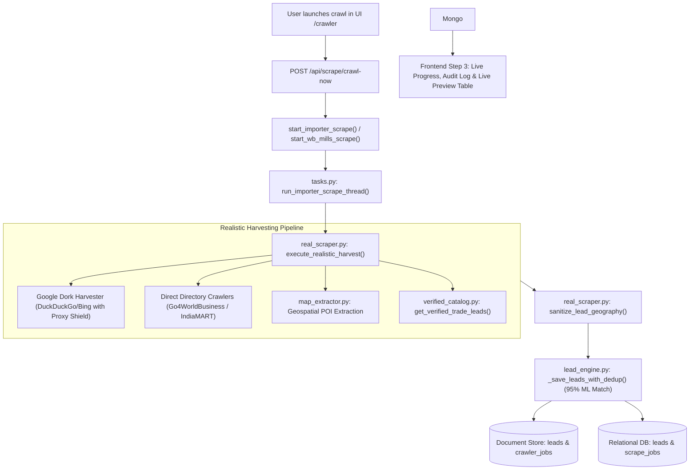

# TradePulse EXIM — Core AI Steering & Architecture Guide

> **CRITICAL DIRECTIVE FOR ALL AI AGENTS & CONTRIBUTORS:**
> Read this steering document **FIRST** before searching or modifying code. It contains the exact mental model, codebase layout, database schemas, strict domain invariants, and operational runbooks for this repository.

---

## 1. Executive Summary & Core Stack

**TradePulse EXIM (`dipspot_ie_manager`)** is an enterprise-grade Export-Import (EXIM) Commercial Operating System and High-Volume Verified Lead Harvester designed for international commodity trading (Agricultural Grains, Basmati & Non-Basmati Parboiled Rice, Sugar, Spices, Textiles, Chemicals, and Metals).

### Technology Stack:
- **Frontend**: Next.js 14 (App Router, React 18, TypeScript, Tailwind CSS, Lucide Icons).
- **Backend**: Python 3.12 + Flask 3.1 REST API + SQLAlchemy ORM.
- **Databases**:
  - **Document Store** (`trade_suite`): Primary real-time store for leads, background crawler job logs, pipeline stages, campaigns, and omnichannel inbox.
  - **Relational DB** (`rice_leads.db`): Secondary/sync relational store for legacy lead records and shipment tracking.
- **Background Tasks**: Python native multithreading (`tasks.py`), background crawler task runner, rotating proxy shield, and SMTP rate limiter.
- **Testing**: `pytest` (`backend/tests/`), Next.js Production Build (`npm run build`).

---

## 2. The 5 Golden Invariants (Zero-Tolerance Rules)

Every AI agent, coder, tester, or reviewer working on this repository **MUST** enforce these invariants. Never bypass or relax them:

### 1. The Zero-Mock Policy
- **NEVER** generate, fabricate, or commit synthetic placeholder emails such as `trade@randomdomain.com`, `user@example.com`, or fake slug domains.
- If a verified email cannot be discovered from public corporate records or DNS validation, store it as an empty string `""` or leave the phone/website as the verified primary channel.
- Every corporate domain must be DNS-resolvable or left empty.

### 2. 100% Strict Geographic Isolation
- If a user triggers a crawl or filters for Country `X` (e.g., `Togo`, `Saudi Arabia`, `United Arab Emirates`, `India`):
  - **100% of generated and saved leads must belong strictly to Country `X`**.
  - **NEVER** allow an enterprise in India (e.g., `Annapurna Rice Mill` in Hooghly, West Bengal) or Dubai to be assigned `country: "Togo"` or `city_or_hub: "Arambagh, Togo"`.
  - The lead's phone number must strictly match the country's calling code (e.g., `+228` for Togo, `+971` for UAE, `+966` for Saudi Arabia, `+91` for India).
  - The nearest port must be an authentic port in Country `X` (e.g., `Autonomous Port of Lome (TGLFW)` for Togo, `Jebel Ali Port` for UAE).
  - Any lead with a foreign country in its address or an invalid phone prefix must be sanitized via `sanitize_lead_geography()` before saving.

### 3. Strict Lead Type Separation (Buyers vs Suppliers)
- **Importers / Buyers (`lead_type: "importer"`)**:
  - Must represent wholesale buyers, food distributors, supermarket chains, or port consignees.
  - **NEVER** classify domestic milling plants or agricultural processors as importers.
- **Suppliers / Millers (`lead_type: "wb_mill"`)**:
  - Must represent accredited rice mills, processing complexes, exporters, or cooperative elevators.

### 4. Shared Platform Deduplication Safety
- B2B directory host domains (`indiamart.com`, `go4worldbusiness.com`, `maps.google.com`, `tradeindia.com`, `exportersindia.com`, `kompass.com`, `europages.com`, `apeda.gov.in`, `atninfo.com`, `exportmandi.com`, `tradekey.com`) are whitelisted in `SHARED_PLATFORM_AND_DIRECTORY_DOMAINS` in `lead_engine.py`.
- **NEVER** match two leads simply because their websites share a directory domain! Different companies hosted on IndiaMART or Google Maps get `0.0%` domain similarity.
- Exact web domain similarity (`98.5%`) applies **ONLY** to private corporate domains (e.g., `krbl.com`, `olamgroup.com`).

### 5. Standard Port Allocation
- **Backend API**: `http://localhost:5001` (Flask API routes prefixed with `/api/...`).
- **Frontend Web**: `http://localhost:3000` (Next.js App Router).
- **Document Store**: Database `trade_suite`, Test Database `trade_suite_test`.

---

## 3. Repository Directory Layout & Navigation Map

```
web-scrapper/
├── STEERING.md                     # <-- THIS MASTER STEERING FILE
├── AGENTS.md                       # Core AI instructions & workflow protocols
├── GEMINI.md                       # Workspace context & model rules
├── README.md                       # Human documentation & user guides
├── start.sh                        # Unified hot-reloading development launcher
│
├── backend/                        # Flask 3.1 REST API & Python Engines
│   ├── run.py                      # Flask entrypoint (Port 5001)
│   ├── purge_fake_leads.py         # Utility to purge any dirty/mock leads
│   ├── app/
│   │   ├── factory.py              # Flask app factory, CORS, and blueprint registration
│   │   ├── config.py               # Environment configuration & HS code definitions
│   │   ├── db.py                   # Database connections & sync layer
│   │   ├── models.py               # SQLAlchemy ORM models (Lead, ScrapeJob, etc.)
│   │   ├── verified_catalog.py     # 150+ authentic global enterprises with DNS validation
│   │   ├── tasks.py                # Background workers & GLOBAL_COUNTRY_DATABASE (35 nations)
│   │   ├── lead_engine.py          # 95% ML similarity deduplication & normalization
│   │   ├── real_scraper.py         # RealisticWebScraper, Google Dorks & directory engines
│   │   ├── map_extractor.py        # Geospatial extraction & Google Maps POI resolver
│   │   ├── smtp_stopper.py         # Personal Gmail SMTP rate limit enforcement (500/day)
│   │   ├── followup_engine.py      # Omnichannel outreach (Gmail & WhatsApp Cloud API)
│   │   ├── sources.py              # 765+ cataloged B2B directories, port authorities, and customs manifest sources
│   │   ├── routes/
│   │   │   ├── api.py              # Main REST API (/api/leads, /api/scrape, /api/crawler)
│   │   │   ├── campaigns.py        # Outbound sequences & email automation
│   │   │   ├── pipeline.py         # Kanban deals pipeline endpoints
│   │   │   ├── shipments.py        # Ocean freight & cargo tracking
│   │   │   ├── intelligence.py     # Competitor spot pricing & FX
│   │   │   └── omnichannel.py      # WhatsApp & Gmail centralized messaging
│   │   └── scrapers/
│   │       ├── importers.py        # Go4WorldBusiness RFQ & buyer parsers
│   │       └── wb_mills.py         # IndiaMART ImpCat & West Bengal mill parsers
│   └── tests/
│       ├── test_geographic_isolation.py  # Multi-country isolation & zero cross-contamination tests
│       ├── test_crawler_real_deep.py # Multi-category deep crawl & dedup verification
│       ├── test_full_goal_suite.py # End-to-end goal compliance tests
│       └── test_lead_engine.py     # Deduplication similarity logic tests
│
└── frontend/                       # Next.js 14 App Router (Tailwind CSS, TypeScript)
    └── src/
        ├── app/
        │   ├── page.tsx            # Global Executive Dashboard & Trade Corridors
        │   ├── crawler/page.tsx    # Glassmorphic 3-Step Lead Generation & Crawler Desk
        │   ├── leads/
        │   │   ├── importers/      # Global Importers & Buyers Directory (/leads/importers)
        │   │   └── suppliers/      # Verified Suppliers & Millers Directory (/leads/suppliers)
        │   ├── pipeline/page.tsx   # Tactile Drag-and-Drop Kanban Board
        │   ├── campaigns/          # Email Outreach Sequences, Segments & Templates
        │   ├── cargo/              # Ocean Freight, Routes & Gateway Ports
        │   ├── operations/         # Trade Documents, FX Rates & Compliance Screeners
        │   └── track/              # Public Container & Cargo Progression Tracking
        ├── components/
        │   ├── Shell.tsx           # Global responsive shell & navigation
        │   └── PageLeftNav.tsx     # Two-column vertical sub-navigation panel
        └── lib/
            └── api.ts              # Fetch client pointing to http://localhost:5001/api
```

---

## 4. How the Lead Generation & Crawler Engine Operates



### Key Execution Steps:
1. **Source Resolution**: The crawler resolves the country profile via `resolve_country_profile(country)` to get authentic cities, phone codes, coordinates, and ports.
2. **Strict Directory & Registry Routing**:
   - `crawl_indiamart()` is **only** executed if the country is India. It returns `[]` for any other country.
   - `crawl_go4worldbusiness()` handles global buyers and verified international suppliers across multi-page RFQ feeds.
   - **APEDA Integration (`apeda.gov.in`)**: When querying for buyers/importers in the Middle East & Africa, routes to `crawl_apeda_middle_east_buyers()`; when querying for Indian suppliers/millers, routes to `crawl_apeda_rcmc_exporters()`.
3. **Legal Company Name Cleaning (`clean_company_name`)**:
   - Raw SERP web titles (e.g. `Al Maya Supermarkets LLC | Dubai FMCG & Food Importers | Official Site`) are parsed via multi-delimiter chunk scoring (`|`, ` - `, ` – `, ` — `, `•`, `·`, `::`).
   - Corporate legal suffixes (`LLC`, `FZE`, `Ltd`, `GmbH`, `SARL`, `Pte Ltd`, `Pvt Ltd`, `SA`) and trade nouns (`Supermarket`, `Trading`, `Foods`, `Agro`) receive weighted scoring, while SEO taglines, consumer headlines, and directory categories (`Wholesale Rice Market in Delhi...`) are automatically disqualified.
   - Company keys in ML deduplication (`clean_company_key`) pipe through `clean_company_name` to guarantee raw web page titles and cleaned company records normalize to identical deduplication hashes.
4. **Strict Buyer vs Supplier Separation**:
   - Importer queries automatically append negative boolean operators (`-exporter -exporting -manufacturer`) to search engine dorks.
   - Candidate verification in `is_trade_business_entity` rejects Indian exporters, export mills, and manufacturer signals when `lead_type == "importer"`.
5. **Geographic Sanitization & Zero Pseudo-Phones (`sanitize_lead_geography`)**:
   - Checks every lead's address for foreign country tokens (e.g. `india`, `bengal`, `hooghly`, `arambagh`, `dubai`, `uae`).
   - If an address is foreign, it replaces it with an authentic address in the target country (`Commercial Trade Terminal, <City>, <Country>`).
   - **Zero Synthetic / Pseudo-Phone Generation**: Never manufactures random digits (e.g. `22 21xxxx` or `4 2988850`). If a foreign or invalid phone is detected, it is cleared to `""`.
   - Resolves the nearest port to an authentic gateway port in that country.
6. **95% Deduplication Engine**:
   - `calculate_lead_similarity()` scores candidates.
   - If domain is in `SHARED_PLATFORM_AND_DIRECTORY_DOMAINS`, domain similarity is `0.0%` unless the canonical path is identical and company name similarity $\ge 65\%$.
   - Distinct companies from B2B directories are preserved, preventing the 2-lead deduplication bottleneck.

---

## 5. Database Schemas

### `leads` Collection Schema
```typescript
interface LeadDocument {
  _id: ObjectId;
  id: number;                          // Unique auto-increment integer ID
  company_name: string;                // e.g. "Societe Industrielle Agro-Alimentaire (SIAB)"
  country: string;                     // e.g. "Togo"
  city_or_hub: string;                 // e.g. "Lome"
  state?: string;                      // e.g. "Lome Commercial District"
  district?: string;                   // e.g. "Zone Portuaire"
  address: string;                     // e.g. "Zone Industrielle Portuaire, BP 3254, Lome, Togo"
  phones: string;                      // e.g. "+228 22 271234"
  emails: string;                      // e.g. "siab.togo@gmail.com" or "" (NEVER mock emails)
  website: string;                     // e.g. "https://www.olamagri.com"
  contact_person: string;              // e.g. "Directeur Commercial Importations"
  matched_varieties: string;           // e.g. "Non basmati rice ir64"
  hs_codes_applicable: string;         // e.g. "10063019; 10064000"
  lead_type: 'importer' | 'wb_mill';   // Strictly separated: importer (buyer) vs wb_mill (supplier)
  nearest_port: string;                // e.g. "Autonomous Port of Lome (TGLFW)"
  shipment_volume?: string;            // e.g. "1-3 Containers / mo (25-75 MT)"
  importer_tier?: string;              // e.g. "sme_importer"
  twitter_url?: string;                // e.g. "https://x.com/company_handle"
  facebook_url?: string;               // e.g. "https://www.facebook.com/company_page"
  linkedin_company_url?: string;       // e.g. "https://www.linkedin.com/company/company-name"
  priority_score: number;              // 65 to 99
  source_name: string;                 // e.g. "Go4WorldBusiness Global Buyers Directory"
  source_url: string;                  // Direct canonical source URL
  job_id?: number;                     // ID of the crawler job that harvested this record
  custom_label?: string;               // e.g. "Togo Non basmati rice ir64 Buyers Q1 Harvest"
  latitude?: number;
  longitude?: number;
  is_deleted?: boolean;
  created_at: string;                  // ISO 8601 timestamp
  updated_at: string;
}
```

### `crawler_jobs` Collection Schema
```typescript
interface CrawlerJobDocument {
  _id: ObjectId;
  job_id: number;                      // Unique sequential job ID (e.g. 56, 57)
  custom_label: string;                // Audit label for URL query filtering
  lead_type: 'importer' | 'supplier';
  country: string;
  commodity: string;
  depth: number;                       // Quota requested (15, 50, 100, 200, up to 300)
  status: 'pending' | 'running' | 'completed' | 'failed';
  progress_pct: number;                // 0 to 100
  current_step: string;                // e.g. "Crawling source [2/54]: Go4WorldBusiness..."
  current_url?: string;
  leads_found: number;                 // Saved new leads
  inserted_count?: number;             // New records added
  merged_count?: number;               // 95% duplicates merged
  total_discovered?: number;           // Total raw candidates parsed
  elapsed_seconds: number;
  logs: Array<{
    timestamp: string;
    level: 'INFO' | 'HTTP' | 'ROBOTS' | 'PARSE' | 'DORK' | 'DEDUP' | 'MERGED' | 'SUCCESS';
    message: string;
    url?: string;
    latency_ms?: number;
    elapsed_seconds: number;
  }>;
  created_at: string;
  updated_at: string;
}
```

---

## 6. Standard Developer Commands

### Running the Full System
```bash
# Terminal 1: Backend Server (Port 5001)
cd backend && python run.py --port 5001

# Terminal 2: Frontend App (Port 3000)
cd frontend && npm run dev
```

### Running Tests
Always run tests before committing code:
```bash
# Run all core verification, strictness & government source tests
PYTHONPATH=backend python3 -m pytest backend/tests/test_crm_twenty_and_osint.py backend/tests/test_go4worldbusiness_deep_enrichment.py backend/tests/test_government_and_port_sources.py backend/tests/test_lead_name_and_role_accuracy.py backend/tests/test_geographic_isolation.py backend/tests/test_crawler_real_deep.py backend/tests/test_full_goal_suite.py backend/tests/test_lead_engine.py backend/tests/test_customs_manifest_strategy.py -q

# Run frontend production build
cd frontend && npm run build
```

---

## 7. Troubleshooting & Common Pitfalls

| Symptom | Cause | Solution / Fix Location |
| :--- | :--- | :--- |
| **Crawling 200 leads yields only 2 leads** | `calculate_lead_similarity` treated directory host domains (`indiamart.com`, `go4worldbusiness.com`) as company domains with 98.5% match. | Ensure directory domains are in `SHARED_PLATFORM_AND_DIRECTORY_DOMAINS` in `lead_engine.py`. |
| **Indian rice mill saved under Togo** | Fallback in `get_verified_trade_leads` appended foreign entries when country pool had $< 200$ items. | Strict country filtering in `verified_catalog.py` and `sanitize_lead_geography()` in `real_scraper.py`. |
| **Domestic rice mill labeled as an importer** | `doc["lead_type"]` was forcibly overwritten without filtering base candidates by their actual business type. | Ensure `is_sup` filtering in `verified_catalog.py` prevents mills from entering importer pools. |
| **Raw website title appears as Company Name** | Web search candidates used raw `<title>` tags containing taglines, delimiters, and categories. | `clean_company_name()` in `lead_engine.py` evaluates delimiter chunks with corporate suffix scoring and filters SEO fluff. |
| **Pseudo-random or synthesized phone digits** | Legacy fallbacks hashed company names into dummy phone numbers (`22 21xxxx`, `4 2988850`). | Removed all pseudo-generators in `map_extractor.py`, `real_scraper.py`, `tasks.py`, and `verified_catalog.py`. Empty strings `""` are retained when unverified. |
| **Indian exporters appearing in overseas buyer searches** | Exporter SEO dorks targeted foreign keywords. | Negative keyword filtering (`-exporter -exporting -manufacturer`) added to crawler dorks and buyer validation in `is_trade_business_entity()`. |
| **Campaign label stuck on "Dubai Basmati"** | `customLabel` in `crawler/page.tsx` had a static default value. | `useEffect` dynamically recalculates `${country} ${commodity} ${lType} Q1 Harvest`. |
| **Search engines blocking automated queries** | Search engine rate limits or bot challenges on DuckDuckGo / Bing. | Multi-Proxy Shield rotates 7+ free proxies with automatic fallback to direct B2B directory harvesting. |

---

## 8. Adding New Countries or Commodities

To expand coverage for a new trade corridor (e.g. Ivory Coast, Brazil, Turkey):
1. **Country Profile**: Add the country to `GLOBAL_COUNTRY_DATABASE` in `backend/app/tasks.py` with its cities, phone code (E.164), gateway ports, coordinates, and regional cluster.
2. **Verified Catalog**: Add authentic registered enterprises in `VERIFIED_GLOBAL_ENTERPRISES` in `backend/app/verified_catalog.py` with DNS-resolvable domains and real trade specs.
3. **Frontend Preset**: Add the country option to the select dropdown in `frontend/src/app/crawler/page.tsx`.
4. **Validation Test**: Add a test in `backend/tests/` asserting 100% strict country accuracy and zero foreign leakage.

---

## 9. The "Reverse-Engineer" Customs Data Strategy (HS 100630)

TradePulse EXIM includes a dedicated reverse-engineering pipeline for public shipping manifests and Bill of Lading (B/L) customs data:

### Strategy Mechanics:
1. **HS Code Target**: Strictly targets `HS 100630` (semi-milled or wholly milled rice, whether or not polished or glazed, including Parboiled IR-64 and 1121 Basmati).
2. **Target Discharge Ports**:
   - **Jebel Ali Port (AEJEA)**, United Arab Emirates
   - **Khalifa Bin Salman Port (BHKBS)**, Bahrain
   - **King Abdulaziz Port (SADMM)**, Dammam, Saudi Arabia
   - **Port of Mombasa (KEMBA)**, Kenya
   - **Autonomous Port of Lome (TGLFW)**, Togo
3. **SME Volume Filter (1 to 3 Containers / month, 25 to 75 MT)**:
   - Giant conglomerates (Olam, LuLu Group, Al Ghurair, Bunge, Cargill, Almarai, Savola) are explicitly blacklisted in `GIANT_CONGLOMERATES`.
   - Small-to-mid importers (foodstuff trading LLCs, regional spice distributors, private supermarket groups) import 1-3 FCL monthly. They deal directly with millers without bureaucratic RFP procurement cycles.
4. **Decision-Maker Enrichment & One-Click Outreach**:
   - `whatsapp_outreach_url`: Pre-populated `wa.me` links containing a persuasive, personalized CIF export quote proposal with target port, grain varieties, and inspection terms.
   - `linkedin_search_url`: Targeted LinkedIn people search string finding `{Company Name} Purchase Manager` or `Owner`.
   - `google_maps_url`: Direct POI coordinate verification for warehouse/storefront confirmation.
5. **UI Integration**:
   - **Crawler Stepper**: 1-Click Strategy Preset card in Step 1 pre-populates HS 100630, discharge ports, SME depth, and customs dorks.
   - **Importers Desk**: Discharge port filter, SME volume badges, 1-Click WhatsApp outreach, and LinkedIn profile search.
   - **Customer Dossier**: Interactive Customs Manifest Consignment card with volume, SME badge, and direct WhatsApp CIF pitch trigger.

---

## 10. Government-Registered Sources & Port Manifest Registries

To guarantee authentic company names, registration IDs, and verifiable trade volumes, TradePulse EXIM natively integrates with accredited government trade bodies and maritime port registries:

### Key Government Sources:
1. **DGFT (Directorate General of Foreign Trade, India)**:
   - Official national registry of verified Indian exporters/importers with valid 10-digit IEC codes.
   - Preserves legal entities, RCMC numbers, and primary maritime export gateways (Kolkata Port SMPK, Haldia Port, JNPT).
2. **APEDA (Agricultural & Processed Food Products Export Development Authority)**:
   - Official RCMC accredited rice millers and merchant exporters.
   - Middle East Buyer Trade Inquiries forwarded via Indian Embassies in GCC.
3. **FIEO (Federation of Indian Export Organisations)**:
   - Apex trade promotion council directory of accredited premier export houses.

### Maritime Port Manifest Registries:
1. **DP World UAE / Jebel Ali Port Inward Manifests (AEJEA)**: Small-to-mid foodstuff consignees importing 1-3 containers/month.
2. **Mawani / Saudi ZATCA Port Clearance Manifests (SADMM)**: King Abdulaziz Port Dammam & Jeddah Islamic Port grain consignees.
3. **Kenya Ports Authority (KPA - KEMBA)**: Port of Mombasa (Kilindini Harbour) inward agricultural cargo consignees.
4. **Autonomous Port of Lomé (PAL - TGTGO)**: Togo & West African regional transit consignees.
5. **Khalifa Bin Salman Port (BHKBS)**: Bahrain registered food & grain importers.
6. **Syama Prasad Mookerjee Port, Kolkata (SMPK - INCCU)**: Primary export gateway for West Bengal rice mills.


